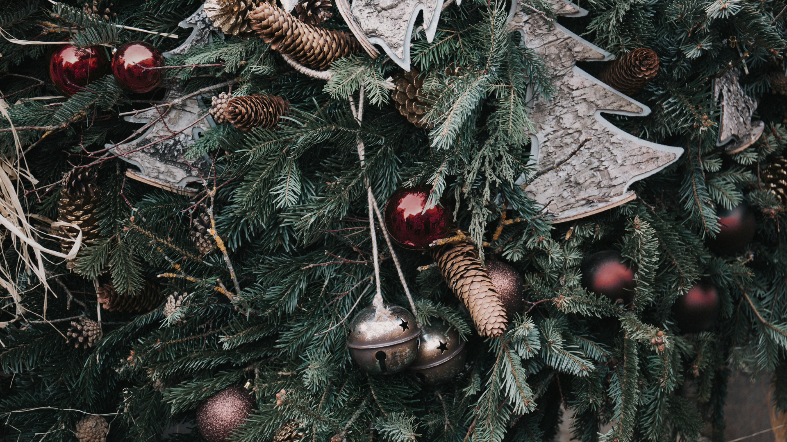

# Joyful



**A cozy Christmas palette for [Omarchy](https://omarchy.org).**

Deep pine-green surfaces (`#12281d`) with a deep maroon accent (`#842e36`),
plus tinsel gold, eggnog cream, holly green and a little sugar-plum pink.
Dark mode, warm and soft, no neon.

## Install

```bash
omarchy theme install https://github.com/NobleDoodle/omarchy-joyful-theme
```

## Contents

| Path           | What it is                                                      |
| -------------- | --------------------------------------------------------------- |
| `colors.toml`  | The palette Omarchy compiles into every app template            |
| `icons.theme`  | Icon theme name (`Yaru-red`)                                    |
| `hyprland.lua` | Joyful's Hyprland look (see below)                              |
| `backgrounds/` | Ten Christmas wallpapers, 3840x2160                             |
| `preview.png`  | Theme-switcher preview                                          |
| `unlock.png`   | Boot-splash logo: the `omarchy` wordmark striped like a candy cane |

## Palette

| Role       | Hex       | Role           | Hex       |
| ---------- | --------- | -------------- | --------- |
| background | `#12281d` | accent         | `#842e36` |
| foreground | `#ece3cf` | red            | `#cb626b` |
| selection  | `#2e4a3a` | yellow (gold)  | `#e2b85f` |
| muted      | `#617b6a` | green (holly)  | `#8fc077` |
| orange     | `#d68a54` | magenta (plum) | `#cf7f9c` |

Foreground on background is 12:1; every ANSI text color clears 4:1 on the background.

## Hyprland look

`hyprland.lua` gives Joyful its own window look while the theme is active:
maroon gradient borders, 3/6 px gaps, 12 px rounded corners, a light
translucency with blur (also behind the bar, menu and Apps grid), and soft
pop-in animations. Switching to another theme drops it again.

Omarchy never runs Lua from a theme it cloned, so after `omarchy theme install`
this file is left out and your own look stays. To use it, read it first, then
install a local copy without the git metadata:

```bash
cp -r ~/.config/omarchy/themes/joyful ~/.config/omarchy/themes/joyful-local
rm -rf ~/.config/omarchy/themes/joyful-local/.git
omarchy theme set joyful-local
```

## Boot splash

```bash
omarchy plymouth set-by-theme joyful   # needs sudo
```

## Wallpapers

Ten wallpapers. Five photos: pinecones and bells with maroon baubles (the
default), a candle on the tree, a holly sprig, tree lights and holly berries.
Viggo Johansen's painting *Glade jul* ("Joyful Christmas", 1891). And four
vintage Christmas postcards from the early 1900s, filling the screen: Ellen
Clapsaddle's holly sled, Santa at his workbench, a red motorcar loaded with
Christmas trees (1908) and "A Joyous Christmas" holly. Every image is public
domain or under CC0, CC BY or CC BY-SA, from Wikimedia Commons (the last two
postcards from publicdomainpictures.net).
Originals smaller than 4K are upscaled with
[Omascayl](https://github.com/NobleDoodle/omascayl)'s backend (remacri-4x)
rather than stretched. Authors and licenses are in
`backgrounds/CREDITS.md`; credit them if you share the images.

## Suggested Wallpaper Additions

Anything with pine, holly, candlelight or a little gilt, and if you want to stay
in period, more postcards from great-grandma's shoebox. Fruitcake optional.

## License

The theme files (`colors.toml`, `icons.theme`, `hyprland.lua`, `unlock.png`, this README) are
MIT. Each wallpaper keeps its own license, listed in `backgrounds/CREDITS.md`.
